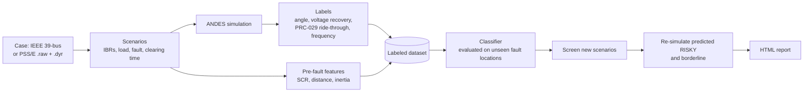

# IBR-FaultScreen

**Fault-scenario screening for grids with inverter-based resources (solar, wind, battery storage).**

IBR-FaultScreen simulates many three-phase fault scenarios, labels each one RISKY or OK by
failure mode (rotor-angle instability, slow voltage recovery, IBR ride-through exposure under
NERC PRC-029-1, frequency), and trains a classifier that ranks new scenarios so engineers know
which contingencies to study in detail first. Every RISKY result shown to a user is verified
by simulation.

> **Screening only.** It prioritizes detailed studies; it does not replace an
> interconnection study. RMS positive-sequence simulation (ANDES), generic WECC IBR models,
> balanced faults.

Version 0.1.0. Author: Shaibu Ibrahim, P.E. License: GPL-3.0-or-later.

## How it works



## Install

Python 3.11 or newer.

```
pip install ibr-faultscreen
```

From source:

```
git clone https://github.com/ishaibu/ibr-faultscreen
cd ibr-faultscreen
python -m venv .venv
.venv\Scripts\activate             # Windows (macOS/Linux: source .venv/bin/activate)
pip install -e ".[dev]"
```

## Quick start

```
ibr-faultscreen example
```

Runs five scenarios on the IEEE 39-bus case (about a minute; the very first run takes
longer while ANDES prepares its models) and opens an HTML report. Results go to
`example_output/`. Every output folder ignores itself in Git.

## Commands

| Command | What it does |
|---|---|
| `ibr-faultscreen check CASE` | Is a case ready? Lists unsupported PSS/E dynamic models, generators that can become IBRs, power flow status |
| `ibr-faultscreen simulate SCENARIOS.yaml` | Runs your scenarios; writes results, figures and a report |
| `ibr-faultscreen cct --bus 16` | Critical clearing time at one or more buses |
| `ibr-faultscreen dataset --n 5000` | Generates a labeled dataset in parallel (resumable, with a data card) |
| `ibr-faultscreen train dataset.csv` | Evaluates rule, logistic and gradient-boosting models on unseen fault locations; trains one |
| `ibr-faultscreen screen --model model.joblib` | Ranks new scenarios and verifies the risky ones by simulation |
| `ibr-faultscreen report results.csv` | Builds the HTML report from any results file |

Add `--help` to any command for its options. A scenario file looks like this:

```yaml
- scenario_id: my_case_1
  load_scale: 1.0
  ibrs: [{gen: 2, kind: solar}, {gen: 6, kind: bess}]
  fault: {bus: 16, clear_time: 0.10}     # seconds; bolted by default
```

Your own model: `ibr-faultscreen check mycase.raw` (the `.dyr` file with the same name is
picked up automatically, or pass `--dyr`), then use `case: mycase.raw` in the scenario file.

## Criteria

Screening limits live in a YAML file. The built-in file
(`src/ibr_faultscreen/data/criteria_prc029.yaml`) holds the NERC PRC-029-1 voltage and
frequency ride-through tables (Table 2, "All Other IBR", which covers PV and BESS; and
Table 3), transcribed from the NERC PDF and checked row by row. Its angle, voltage-recovery and frequency limits are **illustrative**: replace them with
your transmission provider's criteria (`--criteria myfile.yaml`). See
`examples/criteria_example.yaml` for the format.

## IBR models

Each IBR uses the WECC generic models REGCA1 + REECA1 + REPCA1 in ANDES. Parameter
profiles live in `src/ibr_faultscreen/data/ibr_profiles.yaml`:
`andes_example` (ANDES's example case) and `wecc_mvwg_2019` (the illustrative values
in the WECC MVWG Solar PV Plant Modeling and Validation Guideline, 2019). Neither
represents a specific plant. Choose one per IBR in a scenario file
(`{gen: 2, profile: wecc_mvwg_2019}`) or for a whole dataset (`--ibr-profile`).

## Honest handling of solver failures

ANDES cannot solve some bolted faults close to large units, and sometimes "solves" them with
buses stuck at 0 V after clearing (non-physical). IBR-FaultScreen detects both, reruns the case
at milder faults, and labels it **RISKY (confirmed)** when the milder fault is already RISKY or
**RISKY (unresolved)** when it is not, so it never reports a guess as a result. Unresolved
scenarios are left out of model training, and `screen` always simulates scenarios at fault
buses where the solver often fails. See "Unsolvable bolted faults" in `docs/design-spec.md`.

## Validation

The validation tests in `docs/design-spec.md` §14 run on every push (GitHub Actions),
including a single-machine critical clearing time checked against the equal-area criterion,
determinism of the dataset, evaluation on unseen fault locations, and "no RISKY verdict from a
prediction alone". Hand checks are recorded in `docs/verification.md`. Abbreviations are
explained in `docs/glossary.md`.

## Documents

- `docs/design-spec.md`: scope, decisions, methods, tests, limitations
- `docs/review-guide.md`: how to review scenario figures
- `docs/verification.md`: independent hand checks
- `docs/owners-guide.md`: how it works, FAQ, supporting users
- `docs/glossary.md`: abbreviations and terms
- `CHANGELOG.md`: what changed in each version
- `examples/walkthrough.ipynb`: step-by-step notebook

## Citation

See `CITATION.cff`. A DOI is added after the first release is archived on Zenodo.
