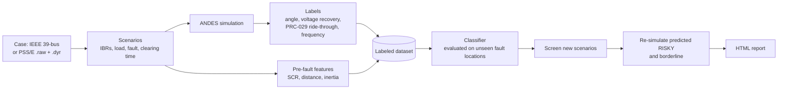

# IBR-FaultScreen

[](https://github.com/ishaibu/ibr-faultscreen/actions/workflows/tests.yml)
[](https://pypi.org/project/ibr-faultscreen/)


[](https://ishaibu.github.io/ibr-faultscreen/demo/)
[](https://colab.research.google.com/github/ishaibu/ibr-faultscreen/blob/main/examples/colab_quickstart.ipynb)
[](https://doi.org/10.5281/zenodo.23290219)
[](https://doi.org/10.5281/zenodo.23290449)

**Fault-scenario screening for grids with inverter-based resources (solar, wind, battery storage).**

IBR-FaultScreen simulates many three-phase fault scenarios, labels each one RISKY or OK by
failure mode (rotor-angle instability, slow voltage recovery, IBR ride-through exposure under
NERC PRC-029-1, frequency), and trains a classifier that ranks new scenarios so engineers know
which contingencies to study in detail first. Every RISKY result shown to a user is verified
by simulation. An equal-area view shows why the synchronous machines stay in step, or do not.

<p align="center">
  <a href="https://ishaibu.github.io/ibr-faultscreen/demo/"></a>
</p>
<p align="center"><em>5,000 simulated faults on the IEEE 39-bus system: press Play and the share of
RISKY faults grows from 16% with no IBRs to 52% with four. <a href="https://ishaibu.github.io/ibr-faultscreen/demo/">Open the interactive demo</a>.</em></p>

> **Screening only.** It prioritizes detailed studies; it does not replace an
> interconnection study. RMS positive-sequence simulation (ANDES), generic WECC IBR models,
> balanced faults.

Version 0.2.0. Author: Shaibu Ibrahim, P.E. License: GPL-3.0-or-later.

## Try it

- **[Build your own grid](https://ishaibu.github.io/ibr-faultscreen/demo/#explore)**, in your browser, nothing to install: pick which
  generators become IBRs, where the fault is and how fast it clears, and see the result at
  once. All 37,120 combinations were simulated in advance. Every case has its own link to share,
  for example [IBRs on generators 8 and 9, fault at bus 16, 6 cycles](https://ishaibu.github.io/ibr-faultscreen/demo/#explore=g89-b16-c6).
- **[Quiz: guess first](https://ishaibu.github.io/ibr-faultscreen/demo/#quiz)**: RISKY or OK? Ten real cases, scored against you and
  the screening model.
- **[Interactive demo report](https://ishaibu.github.io/ibr-faultscreen/demo/)**: the 5,000-scenario dataset with the animated network
  map, the ranked table, the model card, and trajectories you can replay, with the
  equal-area view.
- **[Run real simulations in Google Colab](https://colab.research.google.com/github/ishaibu/ibr-faultscreen/blob/main/examples/colab_quickstart.ipynb)**, free, nothing to install: example
  faults, the interactive report, your own fault bus, clearing time and IBRs with sliders,
  two-scenario comparison, a clearing-time sweep and a critical clearing time. Needs a Google
  account.
- **On your computer:** `pip install ibr-faultscreen`, then `ibr-faultscreen example`. It runs
  five scenarios in about a minute and opens the same kind of report.

<p align="center">
  
</p>
<p align="center"><em>Each scenario plays out when selected: here post-fault overvoltage at IBR buses,
rotor-angle instability, and a bolted fault the solver could not settle (shown honestly).</em></p>

<p align="center">
  <a href="https://ishaibu.github.io/ibr-faultscreen/demo/#explore"></a>
</p>
<p align="center"><em>Build your own grid: every fault bus is colored by its simulated result for the
IBRs and clearing time you pick; tap a bus for the reason and the screening model's view.</em></p>

### Equal-area view

<p align="center">
  
</p>

For each scenario the synchronous machines are reduced to one equivalent machine (the group
that swings ahead against the rest, built from the simulated trajectories) and the energy it
gains while the fault is on (orange) is compared with the energy it gives back after clearing
(blue). If they balance, the swing stops; if not, the machines lose step. On the textbook
single-machine case it matches the hand calculation within 1% (`docs/verification.md` §3). IBRs
have no rotor, so they are not machines in this view: they change it through the network, by
removing the inertia of the machines they replace and by the current they inject. It covers
rotor-angle stability only. `ibr-faultscreen cct` shows it just below and just above the
critical clearing time.

## What it found on the IEEE 39-bus test system

From the 5,000-scenario demo dataset (generic IBR parameters, illustrative limits; the data
card and model card are in the [demo](https://ishaibu.github.io/ibr-faultscreen/demo/)). The
dataset is archived on Zenodo: [doi.org/10.5281/zenodo.23290449](https://doi.org/10.5281/zenodo.23290449).
Version 0.2.0 regenerated it after fixing how unsolvable bolted faults are detected (see
`CHANGELOG.md`); the numbers below are from the corrected dataset, published as version 2.0 of
the same Zenodo record (the DOI above always opens the latest version) together with the
37,120-scenario explorer dataset.

- **Risk grows with IBR share.** 16% of faults were RISKY with no IBRs, 31% with one, 52% with
  four.
- **Ride-through exposure came from overvoltage, not undervoltage.** Of 689 scenarios with
  PRC-029-1 exposure, all but one had the IBR high-side voltage above 1.1 pu after the fault
  cleared (sustained above 1.1 pu, or briefly above 1.2 pu).
  This depends strongly on the generic IBR parameters.
- **The learned model ranks better than a simple rule** (clearing time and lowest SCR), tested
  only on fault buses it never saw: AUC 0.86 vs. 0.78, average precision 0.67 vs. 0.52.

| Share of RISKY scenarios caught (recall) | Gradient boosting sends to simulation | Simple rule sends to simulation |
|---|---|---|
| 90% | 52% | 56% |
| 95% | 60% | 62% |
| 99% | 74% | 82% |

The gain over the rule is largest when almost nothing may be missed. `screen` also always
simulates fault buses where the solver often fails; with that, it caught 96% of RISKY and 93% of
unsolvable scenarios while simulating 68% of all scenarios. On the 37,120 explorer cases
(base load, scored by models trained without the fault bus; the solver-hard bus list comes from
the whole training dataset) the same policy caught 97.5% of RISKY and 95% of unknown-outcome
cases while simulating 72%. These numbers are for one test system with
generic models: retrain on your own network before relying on them.

## How it works



## Install

Python 3.11 or newer.

```
pip install ibr-faultscreen
```

From source:

```
git clone https://github.com/ishaibu/ibr-faultscreen
cd ibr-faultscreen
python -m venv .venv
.venv\Scripts\activate             # Windows (macOS/Linux: source .venv/bin/activate)
pip install -e ".[dev]"
```

## Quick start

```
ibr-faultscreen example
```

Runs five scenarios on the IEEE 39-bus case (about a minute; the very first run takes
longer while ANDES prepares its models) and opens an HTML report. Results go to
`example_output/`. Every output folder ignores itself in Git.

## Commands

| Command | What it does |
|---|---|
| `ibr-faultscreen check CASE` | Is a case ready? Lists unsupported PSS/E dynamic models, generators that can become IBRs, power flow status |
| `ibr-faultscreen simulate SCENARIOS.yaml` | Runs your scenarios; writes results, figures and a report |
| `ibr-faultscreen cct --bus 16` | Critical clearing time at one or more buses, with the equal-area view just below and above it |
| `ibr-faultscreen dataset --n 5000` | Generates a labeled dataset in parallel (resumable, with a data card); `--scenarios LIST.csv` runs your own list instead |
| `ibr-faultscreen train dataset.csv` | Evaluates rule, logistic and gradient-boosting models on unseen fault locations; trains one |
| `ibr-faultscreen screen --model model.joblib` | Ranks new scenarios and verifies the risky ones by simulation |
| `ibr-faultscreen report results.csv` | Builds the HTML report from any results file |

Add `--help` to any command for its options. A scenario file looks like this:

```yaml
- scenario_id: my_case_1
  load_scale: 1.0
  ibrs: [{gen: 2, kind: solar}, {gen: 6, kind: bess}]
  fault: {bus: 16, clear_time: 0.10}     # seconds; bolted by default
```

From Python:

```python
from ibr_faultscreen.criteria import default_criteria
from ibr_faultscreen.label import label
from ibr_faultscreen.scenario import FaultSpec, IBRSpec, Scenario
from ibr_faultscreen.simulate import simulate

scenario = Scenario("my_case", ibrs=(IBRSpec(2), IBRSpec(6, kind="bess")),
                    fault=FaultSpec(16, clear_time=0.10))
result = simulate(scenario)                  # ANDES time-domain run
verdict = label(result, default_criteria())  # PRC-029-1 ride-through and other checks
print(result.status, "RISKY" if verdict.risky else "OK", verdict.reasons)
```

Your own model: `ibr-faultscreen check mycase.raw` (the `.dyr` file with the same name is
picked up automatically, or pass `--dyr`), then use `case: mycase.raw` in the scenario file.

## Criteria

Screening limits live in a YAML file. The built-in file
(`src/ibr_faultscreen/data/criteria_prc029.yaml`) holds the NERC PRC-029-1 voltage and
frequency ride-through tables (Table 2, "All Other IBR", which covers PV and BESS; and
Table 3), transcribed from the NERC PDF and checked row by row. Its angle, voltage-recovery and frequency limits are **illustrative**: replace them with
your transmission provider's criteria (`--criteria myfile.yaml`). See
`examples/criteria_example.yaml` for the format.

## IBR models

Each IBR uses the WECC generic models REGCA1 + REECA1 + REPCA1 in ANDES. Parameter
profiles live in `src/ibr_faultscreen/data/ibr_profiles.yaml`:
`andes_example` (ANDES's example case) and `wecc_mvwg_2019` (the illustrative values
in the WECC MVWG Solar PV Plant Modeling and Validation Guideline, 2019). Neither
represents a specific plant. Choose one per IBR in a scenario file
(`{gen: 2, profile: wecc_mvwg_2019}`) or for a whole dataset (`--ibr-profile`).

## Honest handling of solver failures

ANDES cannot solve some bolted faults close to large units, and sometimes "solves" them with
buses stuck at 0 V after clearing (non-physical). IBR-FaultScreen detects both, reruns the case
at milder faults, and labels it **RISKY (confirmed)** when the milder fault is already RISKY or
**RISKY (unresolved)** when it is not, so it never reports a guess as a result. Unresolved
scenarios are left out of model training, and `screen` always simulates scenarios at fault
buses where the solver often fails. See "Unsolvable bolted faults" in `docs/design-spec.md`.

## Validation

The validation tests in `docs/design-spec.md` §14 run on every push (GitHub Actions),
including a single-machine critical clearing time checked against the equal-area criterion,
determinism of the dataset, evaluation on unseen fault locations, and "no RISKY verdict from a
prediction alone". Hand checks are recorded in `docs/verification.md`. Abbreviations are
explained in `docs/glossary.md`.

## Documents

- `docs/design-spec.md`: scope, decisions, methods, tests, limitations
- `docs/verification.md`: independent hand checks
- `docs/glossary.md`: abbreviations and terms
- `CHANGELOG.md`: what changed in each version
- `examples/colab_quickstart.ipynb`: run in the browser with Google Colab
- `examples/walkthrough.ipynb`: step-by-step notebook
- `tools/build_demo.py`: rebuilds the interactive demo from a dataset
- `tools/explorer_scenarios.py`, `tools/explorer_data.py`: the scenario list and the data behind the explorer and quiz

## Contributing

Questions, bug reports and ideas are welcome: open an
[issue](https://github.com/ishaibu/ibr-faultscreen/issues) (templates help you include what is
needed). Please never attach confidential network models; an anonymized description or the
IEEE 39-bus case is enough. See `CONTRIBUTING.md`.

## How to cite

If you use IBR-FaultScreen, please cite the software, and the dataset if you use it:

> Ibrahim, S. (2026). *IBR-FaultScreen: fault-scenario screening for grids with
> inverter-based resources* (Version 0.2.0) [Computer software]. Zenodo.
> https://doi.org/10.5281/zenodo.23290219

> Ibrahim, S. (2026). *IBR-FaultScreen fault-screening datasets: 5,000 sampled and 37,120
> exhaustive fault scenarios on the IEEE 39-bus system with inverter-based resources*
> (Version 2.0) [Data set]. Zenodo. https://doi.org/10.5281/zenodo.23290449

These DOIs always point to the latest version; each version also has its own DOI on its
Zenodo page. GitHub's "Cite this repository" button (from `CITATION.cff`) gives APA and
BibTeX.
