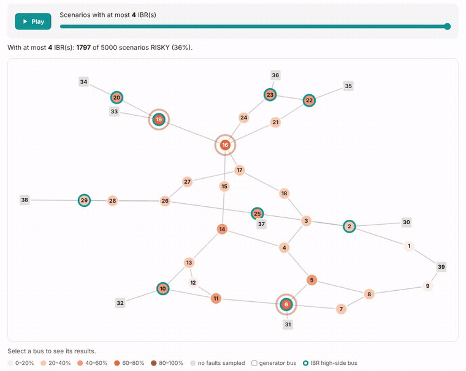

# IBR-FaultScreen

Fault-scenario screening for grids with inverter-based resources (solar, wind, battery storage).

- **[Interactive demo report](demo/)**: 5,000 simulated faults on the IEEE 39-bus system
  (generic IBR models, illustrative limits). Press Play on the map, sort the table, replay the
  trajectories.
- **[Design specification](design-spec)**, **[verification record](verification)** and
  **[glossary](glossary)**
- **[Source code, installation and documentation](https://github.com/ishaibu/ibr-faultscreen)**:
  `pip install ibr-faultscreen`

Screening only: results do not replace interconnection studies.
